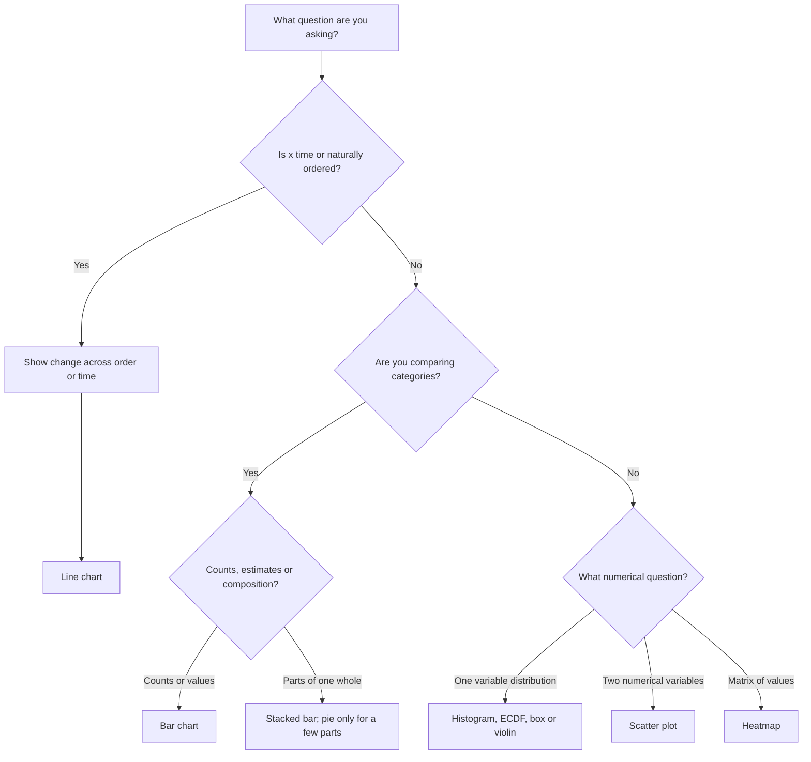

# Lesson 3: Matplotlib Bar Charts

## Learning outcomes
You should be able to choose bar charts for categorical comparisons; create vertical and horizontal bars with `bar()` and `barh()`; sort categories; create grouped and stacked bars; add value labels and error bars; and explain why a zero baseline matters.

## 1. What does a bar chart show?

A bar chart compares a numerical value across categories. Each bar represents one category, and its length is proportional to the value. The category is usually on the horizontal axis for vertical bars and on the vertical axis for horizontal bars.

Examples:
- Number of learners by course.
- Revenue by region.
- Complaints by product type.
- Average score by class.

Use a bar chart when categories are distinct and the reader needs to compare their values. Do not use it to show a continuous distribution; a histogram is designed for that purpose. A bar chart has gaps between categories because each category is separate. Histogram bars usually touch because the numerical intervals are adjacent.

## 2. A visual chart-selection decision tree

Use the question to narrow the chart choice before writing code:



This tree is a starting point, not an automatic rule. A time series with many groups may need facets rather than dozens of lines. A composition with many categories is usually clearer as a sorted bar chart. Always check the data structure and the audience's task.

## 2. Vertical bars: ax.bar()

The function has the general form:

```python
ax.bar(categories, heights, width=0.8, color=None, label=None)
```

- First argument: category positions or labels.
- Second argument: bar heights.
- `width`: relative bar width (default is 0.8).
- `color`: fill colour or a sequence of colours.
- `edgecolor`: border colour.
- `label`: series name for a legend.
- `yerr`: optional uncertainty/error values.
- `capsize`: width of the small end caps on error bars.

Begin with:

```python
import matplotlib.pyplot as plt

departments = ["Sales", "Support", "Engineering", "Finance"]
tickets = [120, 95, 70, 55]

fig, ax = plt.subplots(figsize=(8, 4))
bars = ax.bar(departments, tickets, color="cornflowerblue",
              edgecolor="black", width=0.65)
ax.set(title="Tickets handled by department",
       xlabel="Department", ylabel="Number of tickets")
ax.set_ylim(0, 140)
ax.grid(axis="y", alpha=0.25)
ax.set_axisbelow(True)
plt.show()
```

The returned `bars` object contains the rectangles Matplotlib created. You can use it to add labels, change individual bar properties or inspect the bar positions.

## 3. Add value labels to bars

A chart may benefit from exact values printed above bars. Matplotlib provides `ax.bar_label()`:

```python
fig, ax = plt.subplots(figsize=(8, 4))
bars = ax.bar(departments, tickets)
ax.bar_label(bars, padding=3, fmt="%.0f")
ax.set_ylim(0, 140)
plt.show()
```

- `bars` is the container returned by `ax.bar()`.
- `padding=3` moves labels slightly away from bar ends.
- `fmt="%.0f"` formats values as whole numbers.

Do not add labels if they overlap or make a dense chart unreadable. For many categories, a sorted horizontal chart may be clearer.

## 4. Horizontal bars: ax.barh()

Long category names often fit better on the vertical axis:

```python
import matplotlib.pyplot as plt

courses = ["Data Science", "Data Analytics", "Python Basics",
           "Business Intelligence", "Statistics"]
enrolments = [180, 145, 220, 95, 130]

# Sort from smallest to largest so the largest appears at the top.
ordered = sorted(zip(enrolments, courses))
values = [item[0] for item in ordered]
labels = [item[1] for item in ordered]

fig, ax = plt.subplots(figsize=(8, 5))
bars = ax.barh(labels, values, color="teal")
ax.bar_label(bars, padding=4)
ax.set(title="Enrolments by course",
       xlabel="Number of learners", ylabel="Course")
ax.set_xlim(0, 250)
ax.grid(axis="x", alpha=0.25)
ax.set_axisbelow(True)
plt.show()
```

`ax.barh(y_categories, widths)` uses category labels on the y-axis and bar lengths along the x-axis. Sorting makes comparisons easier. In a horizontal bar chart, ascending order places the largest at the top when the values are passed from smallest to largest.

## 5. Grouped bars: compare subgroups side by side

Suppose you need to compare enrolments across two years for each course. Grouped bars place the year values beside each other:

```python
import numpy as np
import matplotlib.pyplot as plt

courses = ["Python", "SQL", "Statistics", "Visualisation"]
year_1 = [80, 65, 50, 45]
year_2 = [95, 72, 68, 61]

x = np.arange(len(courses))
width = 0.36

fig, ax = plt.subplots(figsize=(9, 4))
bars1 = ax.bar(x - width/2, year_1, width, label="2025")
bars2 = ax.bar(x + width/2, year_2, width, label="2026")

ax.set_xticks(x)
ax.set_xticklabels(courses)
ax.set_ylabel("Learners")
ax.set_title("Course enrolments: 2025 versus 2026")
ax.legend(title="Year")
ax.bar_label(bars1, padding=2, fontsize=8)
ax.bar_label(bars2, padding=2, fontsize=8)
plt.show()
```

Here, `np.arange(len(courses))` creates numeric positions 0, 1, 2 and 3. The first series is shifted left by half the bar width; the second is shifted right. This prevents bars from covering one another. `set_xticks()` places category positions, while `set_xticklabels()` supplies the names.

Grouped bars are useful when direct side-by-side comparison matters. They become cluttered when there are many subgroups.

## 6. Stacked bars: show composition within categories

A stacked bar places one subgroup on top of another. It is useful when the total and its components both matter:

```python
import matplotlib.pyplot as plt

regions = ["North", "South", "East"]
online = [40, 55, 35]
in_store = [60, 45, 65]

fig, ax = plt.subplots(figsize=(7, 4))
ax.bar(regions, online, label="Online")
ax.bar(regions, in_store, bottom=online, label="In-store")
ax.set(title="Orders by region and channel",
       xlabel="Region", ylabel="Orders")
ax.legend()
plt.show()
```

The `bottom=online` argument tells Matplotlib to start the in-store bar at the height of the online bar. Without it, the two series would overlap from zero.

Stacked bars are useful for totals and broad composition. However, only the bottom segment shares a common baseline, so comparing the middle or top segments across categories is difficult. Use grouped bars when accurate subgroup comparison is the priority.

## 7. Percentage-stacked bars

When category totals differ, raw stacked bars can make composition difficult to compare. A 100% stacked chart converts each group to proportions:

```python
import numpy as np
import matplotlib.pyplot as plt

regions = ["North", "South", "East"]
online = np.array([40, 55, 35])
in_store = np.array([60, 45, 65])
totals = online + in_store
online_pct = online / totals * 100
store_pct = in_store / totals * 100

fig, ax = plt.subplots(figsize=(7, 4))
ax.bar(regions, online_pct, label="Online")
ax.bar(regions, store_pct, bottom=online_pct, label="In-store")
ax.set_ylim(0, 100)
ax.set_ylabel("Share of orders (%)")
ax.set_title("Order channel mix by region")
ax.legend()
plt.show()
```

The denominator is each region's total orders. State that clearly: percentages describe within-region composition, not absolute order volume.

## 8. Error bars on bars

An error bar can show uncertainty or variability around an estimate. It must be explained in the title, legend or caption. For example:

```python
import matplotlib.pyplot as plt

groups = ["A", "B", "C"]
mean_score = [68, 74, 71]
standard_error = [2.5, 3.0, 1.8]

fig, ax = plt.subplots(figsize=(7, 4))
ax.bar(groups, mean_score, yerr=standard_error,
       capsize=5, color="slateblue")
ax.set(title="Mean score by group (±1 standard error)",
       xlabel="Group", ylabel="Mean score")
plt.show()
```

This chart displays plus/minus one standard error, not a 95% confidence interval. Never label error bars vaguely as “error” without saying what they represent.

## 9. Why bar charts normally start at zero

Bar length encodes magnitude. If one bar is 100 and another is 110, a vertical axis starting at 95 makes the second bar look several times taller even though it is only 10% larger. A zero baseline preserves the visual relationship between bar length and value.

For bar charts, start at zero unless there is a carefully justified alternative representation. If the values are close and a zero-based chart hides small differences, use a dot plot or clearly labelled table rather than quietly truncating the bars.

## 10. Common mistakes

- Using a bar chart for continuous measurements instead of a histogram.
- Forgetting to sort categories when ranking is the message.
- Using too many colours without a reason.
- Stacking categories when the reader needs to compare every subgroup precisely.
- Hiding the zero baseline.
- Showing percentages without stating their denominator.
- Printing every value on a crowded chart.

## Guided practice

1. Create a vertical bar chart for five departments.
2. Recreate it horizontally and decide which handles long labels better.
3. Add labels using `bar_label()`.
4. Create a grouped chart comparing two years.
5. Create a stacked chart for two sales channels and explain the denominator if converted to percentages.

## Independent practice

Use a dataset with at least five categories. Produce (a) a sorted horizontal comparison, (b) a grouped comparison if a meaningful second variable exists, and (c) a 100% stacked composition if the data supports it. Explain which question each chart answers and why the other chart forms would be less suitable.

## Knowledge check

1. What is the difference between `bar()` and `barh()`?
2. What does the `bottom` argument do in a stacked bar chart?
3. Why do grouped bars make subgroup comparisons easier?
4. Why should a bar chart normally use a zero baseline?
5. What denominator does a 100% stacked chart use?

## Lesson summary

Bar charts compare categories. Matplotlib's `bar()` draws vertical bars and `barh()` draws horizontal bars. Grouped bars support side-by-side comparisons; stacked bars show totals and composition. Sorting, labels, honest baselines and clearly stated denominators make the chart useful rather than merely attractive.