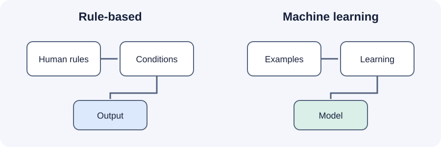
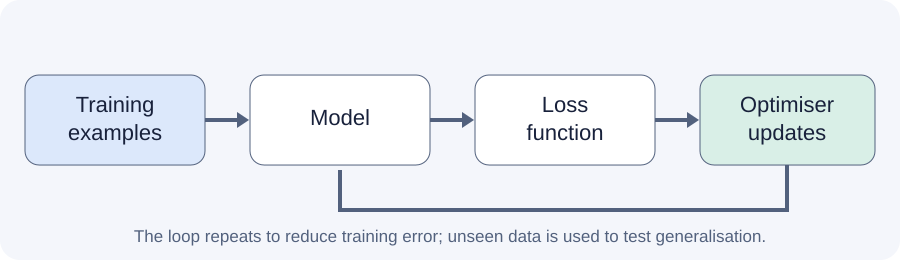

# Lesson 1: What Machine Learning Is and When to Use It

## Learning outcomes
Explain machine learning in plain language; distinguish rule-based programming from learning from examples; identify observations, features, targets, models and algorithms; explain training and generalisation; and decide whether ML is appropriate for a problem.

## 1. Start with a real problem
Imagine an online learning platform wants to identify learners who may not complete a course. A simple rule might flag anyone who has not logged in for 14 days. This is rule-based programming: a person writes the rule explicitly. It may work, but it could miss learners who log in regularly without making progress, or flag learners who are temporarily away but will return.

Machine learning (ML) is a way of using examples to learn patterns that can support predictions or decisions. Instead of manually writing every rule, we provide data and a learning procedure. The procedure adjusts a model so that its outputs fit known examples, then we evaluate whether the learned pattern works on cases that were not used to train it.



## 2. Important vocabulary
- **Observation / example:** one case in a dataset, such as one learner.
- **Feature:** an input variable that describes an observation, such as attendance or time since last login.
- **Target / label:** the outcome we want to predict, such as course completion.
- **Model:** a mathematical function or system that maps input information to an output.
- **Algorithm:** the procedure used to learn the model's parameters or structure.
- **Training:** using examples to fit a model.
- **Prediction / inference:** using a fitted model on new input.
- **Generalisation:** how well the model performs on examples it has not seen during training.

A feature is not the same as a target. If we want to predict course completion, completion is the target. Attendance and early assignment activity may be features, provided they are available at the time the prediction is made.

## 3. How supervised learning works
In supervised learning, we provide examples with known answers. The model makes predictions, a loss function measures how wrong those predictions are, and an optimisation algorithm adjusts model parameters to reduce the loss.



The process is repeated:
1. Provide training features.
2. The model produces predictions.
3. Compare predictions with known training targets.
4. Calculate a loss.
5. Update model parameters.
6. Repeat until a stopping condition is met.
7. Evaluate on separate data the model did not learn from.

A model can learn useful patterns, but it can also memorise noise. This is why training performance alone is not enough.

## 4. When is ML useful?
ML may be appropriate when the task occurs repeatedly, relevant examples are available, an outcome can be measured, patterns are difficult to express as simple rules, and predictions can improve a real decision.

ML may be unnecessary or unsuitable when:
- a simple rule or SQL query solves the task more reliably;
- there are too few or unrepresentative examples;
- the target is vague or inconsistently recorded;
- the future process differs greatly from historical data;
- errors could cause serious harm and cannot be controlled;
- nobody knows what action should follow a prediction.

A prediction is not automatically a decision. If a model estimates a 70% probability of non-completion, a team still needs a policy for what to do. It may offer support, send a reminder or take no action. Those choices have costs and consequences.

## 5. Prediction is not causation
Suppose learners who miss assignments are more likely to withdraw. Missing assignments may be a useful predictive signal, but that does not prove missed assignments cause withdrawal. Financial pressure, health, workload or poor course design may influence both. Predictive models learn associations; causal claims require different methods and assumptions.

## 6. Features must be available at prediction time
Imagine the platform wants to make a prediction at the end of week two. Final exam score, final completion status and the date the learner withdrew are not available at that moment. Using them would leak future information into the model and create an unrealistic result.

A good project defines the prediction time before selecting features.

## 7. A first Python example: establish a baseline
Install the core packages in your VS Code virtual environment:
```bash
python -m pip install numpy pandas scikit-learn
```

```python
import pandas as pd
from sklearn.dummy import DummyClassifier
from sklearn.model_selection import train_test_split
from sklearn.metrics import accuracy_score

learners = pd.DataFrame({
    "weekly_logins": [1, 5, 2, 7, 3, 8, 2, 6, 1, 9, 4, 7],
    "assignments_early": [0, 2, 1, 3, 0, 4, 1, 2, 0, 4, 1, 3],
    "days_inactive": [20, 2, 15, 1, 12, 0, 18, 3, 25, 1, 8, 2],
    "completed": [0, 1, 0, 1, 0, 1, 0, 1, 0, 1, 0, 1]
})
X = learners[["weekly_logins", "assignments_early", "days_inactive"]]
y = learners["completed"]

X_train, X_test, y_train, y_test = train_test_split(
    X, y, test_size=0.25, random_state=42, stratify=y
)
baseline = DummyClassifier(strategy="most_frequent")
baseline.fit(X_train, y_train)
predictions = baseline.predict(X_test)
print("Baseline accuracy:", accuracy_score(y_test, predictions))
```

X contains the features and y contains the target. test_size=0.25 reserves 25% of rows for testing. random_state makes the split repeatable. stratify=y attempts to preserve the class proportions in both sets. fit() learns from training examples; predict() produces outputs for the held-out examples.

The dataset is invented and very small. The baseline is not a useful deployed predictor; it is a starting point that a later model must beat.

## 8. Frame a problem before coding
Write down:
1. What decision will the prediction support?
2. What does one row represent?
3. At what time must the prediction be available?
4. What exact target will be predicted?
5. Which features are available at that time?
6. What are the costs of false positives and false negatives?
7. Which metric reflects the real objective?
8. What simple baseline must the model beat?

## Common mistakes
- Calling every automated rule machine learning.
- Including the target among the input features.
- Using information that only exists after the prediction time.
- Treating high training accuracy as proof of generalisation.
- Assuming correlation proves cause.
- Starting with a complex model before establishing a baseline.

## Guided practice
A bank wants to flag transactions that may be fraudulent. Define one observation, possible features, target, prediction time and consequences of false positives and false negatives. Identify one example of information that would leak the outcome.

## Independent practice
Choose a problem such as student completion, delivery delay, customer renewal or equipment failure. Write a one-page problem brief using the eight questions above. Do not train a model yet.

## Knowledge check
1. Explain feature versus target.
2. What does a model learn during training?
3. Why is a baseline useful?
4. Why does predictive association not prove causation?
5. Give two cases where ML may not be appropriate.

## Lesson summary
Machine learning learns patterns from examples. Good ML starts with a well-defined decision, a trustworthy target and data that would genuinely be available when predictions are made.