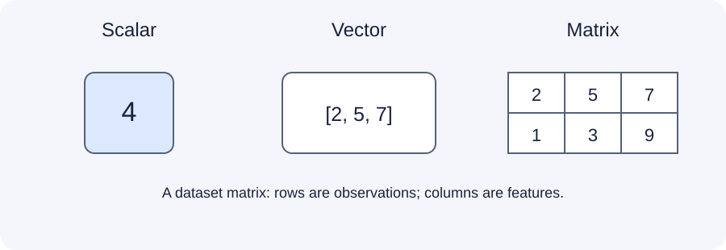

# Lesson 5: Mathematics Refresher — Vectors and Matrices

## Learning outcomes
Explain scalars, vectors, matrices, dimensions and shape; represent one observation and a whole dataset mathematically; calculate dot products and matrix multiplication; understand transpose; and connect linear algebra to model predictions.

## 1. Why machine learning uses linear algebra
Most tabular ML data can be represented as numbers arranged in rows and columns. An algorithm must repeatedly combine these numbers with learned parameters. Linear algebra gives us a compact, efficient language for doing that.

A **scalar** is one number, such as 4. A **vector** is an ordered list of numbers. A **matrix** is a rectangular arrangement of numbers. A **tensor** generalises this idea to arrays with more than two dimensions; images, for example, can be represented as height × width × colour-channel arrays.



## 2. Represent an observation as a vector
Suppose a learner is described by study hours, attendance percentage and completed assignments. One learner could be represented as:
\[
x = [4, 85, 6]
\]
This is a vector with three features. The order matters: if the model expects [study hours, attendance, assignments], do not supply [attendance, study hours, assignments]. The numbers would be interpreted incorrectly even though the vector still has three elements.

A dataset containing 100 learners and three features can be represented by a matrix X with shape (100, 3). Rows are observations; columns are features. In scikit-learn, the conventional input X is two-dimensional, even when there is only one feature.

## 3. Shape is a contract
The shape tells you the size of each dimension. A matrix with 100 rows and 3 columns has shape (100, 3). A weight vector for those features has shape (3,). The dimensions must align for the intended operation.

NumPy:
```python
import numpy as np

X = np.array([
    [2.0, 70.0],
    [4.0, 85.0],
    [6.0, 95.0]
])
weights = np.array([3.0, 0.2])
print(X.shape)       # (3, 2): three rows, two features
print(weights.shape) # (2,)
```

The first dimension of X is the number of observations. The second is the number of features. This distinction is crucial when debugging shape errors.

## 4. Dot product: combine features with weights
A dot product multiplies matching elements and adds the products:
\[
[2, 5] \cdot [3, 4] = (2\times3)+(5\times4)=26
\]
In a linear model, weights express how the model combines input features. A simplified prediction is:
\[
\hat y = w_1x_1 + w_2x_2 + \dots + w_px_p + b
\]
Here, x values are features, w values are learned weights, b is an intercept and ŷ is the prediction. The weights are not automatically causal effects. Their interpretation depends on the model, feature scaling and relationships among variables.

```python
x = np.array([2.0, 5.0])
w = np.array([3.0, 4.0])
dot = x @ w
print(dot)  # 26.0
```
The @ operator performs matrix multiplication or dot product depending on array dimensions.

## 5. Matrix multiplication: many predictions at once
For three observations and two features, X has shape (3, 2). A weight vector has shape (2,). Multiplying X @ weights produces one prediction per row, with shape (3,).

```python
X = np.array([[2, 10], [3, 20], [4, 30]], dtype=float)
weights = np.array([0.5, 0.1])
intercept = 1.0
predictions = X @ weights + intercept
print(predictions)
print(predictions.shape)
```

For the first row, the prediction is 2×0.5 + 10×0.1 + 1 = 3. The same calculation is performed for every row. This is why matrix operations are so useful: one operation represents many calculations.

## 6. Transpose and compatible dimensions
Transpose swaps rows and columns. If X has shape (3, 2), X.T has shape (2, 3). Matrix multiplication A @ B is valid when the number of columns in A equals the number of rows in B. If A has shape (m, n), B must have shape (n, p), and the result has shape (m, p).

```python
print("X:", X.shape)
print("X transpose:", X.T.shape)
print("X @ weights:", (X @ weights).shape)
```

A common error is trying to multiply incompatible shapes. Do not fix this by blindly transposing arrays. First establish what each axis represents.

## 7. Scaling and units
Suppose one feature is age in years (18–70) and another is annual income in naira (hundreds of thousands or millions). Their numeric magnitudes differ. Distance-based algorithms and gradient-based optimisation can be sensitive to feature scale. Standardisation is often useful for these models. Tree-based models usually do not require the same scaling because they split on feature thresholds.

## 8. Common mistakes
- Reversing rows and columns.
- Changing feature order between training and prediction.
- Confusing a vector's length with a matrix's number of rows.
- Using matrix multiplication when element-wise multiplication was intended.
- Assuming every model weight is a causal effect.
- Scaling data using statistics calculated from the full dataset before splitting.

## Guided practice
Create a matrix with four observations and three features. Write down its shape. Create a three-element weight vector and calculate predictions by hand for the first row, then verify with NumPy. Change the weight vector to two elements and explain the shape error.

## Independent practice
Create a small dataset of five observations and three numeric features. Calculate one weighted prediction manually and with NumPy. Include an intercept. Explain what each dimension represents and why feature order matters.

## Knowledge check
1. What is the difference between a scalar, vector and matrix?
2. What does shape (120, 5) mean?
3. Why must the number of weights match the number of features?
4. What is a transpose?
5. Why can feature scaling matter?

## Lesson summary
Linear algebra lets us represent datasets and model calculations efficiently. Understanding dimensions and shape makes model behaviour easier to reason about and prevents common implementation errors.