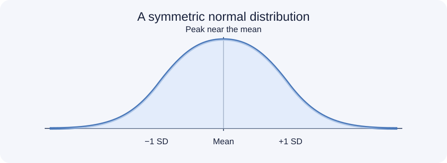

# Lesson 6: Mathematics Refresher — Statistics and Probability

## Learning outcomes
Calculate and interpret mean, median, range, variance, standard deviation and quantiles; explain probability and conditional probability; understand distributions and sampling variation; and connect these ideas to classification and evaluation.

## 1. Why statistics matters
A dataset is not just a collection of values. We need ways to describe its centre, spread, shape and uncertainty. Statistics helps us summarise observations and reason carefully about how well a sample represents a wider population.

## 2. Measures of centre
The **mean** is the sum of values divided by the number of values. It uses every value, so extreme values can pull it strongly. The **median** is the middle value after sorting; with an even number of values, it is the average of the two middle values. The **mode** is the most frequently occurring value and is particularly useful for categorical data.

Example: salaries [50, 55, 60, 65, 300] have mean 106 but median 60. The unusually high value pulls the mean upward. Neither statistic is universally best; choose based on the question and distribution.

## 3. Measures of spread
The **range** is maximum minus minimum. Variance measures average squared deviation from the mean. Standard deviation is the square root of variance and is expressed in the original unit.

For a sample, the common sample variance divides the sum of squared deviations by n−1 rather than n. This correction is used when estimating population variance from a sample. In NumPy, ddof=1 requests the sample form; ddof=0 calculates population-style variance for the supplied values.

```python
import numpy as np
scores = np.array([52, 61, 64, 68, 70, 73, 77, 85])
print("Mean:", scores.mean())
print("Median:", np.median(scores))
print("Sample standard deviation:", scores.std(ddof=1))
print("Quartiles:", np.quantile(scores, [0.25, 0.50, 0.75]))
```

## 4. Quantiles and distributions
The 25th percentile is a value at or below which approximately 25% of observations fall, under the selected quantile convention. The median is the 50th percentile. The interquartile range (IQR) is Q3 − Q1 and describes the middle half of the data.

A distribution describes how values occur. It may be symmetric, skewed, multimodal or have heavy tails. Many ML algorithms do not require every feature to be normally distributed, despite a common misconception. Distribution shape still matters for outliers, transformations, uncertainty and model assumptions.



## 5. Probability
Probability describes uncertainty on a scale from 0 to 1. An impossible event has probability 0; a certain event has probability 1. The probability of an event A is written P(A).

For a fair six-sided die, P(rolling a 4) = 1/6. If an event has probability 0.8 under a well-defined model, it does not mean the next individual outcome is guaranteed. It means that across many comparable cases, the event is expected about 80% of the time if the probability model is calibrated and applicable.

## 6. Conditional probability
Conditional probability asks how likely A is when B is already known:
\[
P(A\mid B)=\frac{P(A\cap B)}{P(B)}
\]
provided P(B) is greater than zero. In classification, we often want a probability of a class given observed features, such as P(churn=1 | usage, tenure, complaints).

Bayes' theorem connects conditional probabilities:
\[
P(A\mid B)=\frac{P(B\mid A)P(A)}{P(B)}
\]
It is useful for updating beliefs using evidence and underlies Naive Bayes classifiers. The “naive” assumption is conditional independence of features given the class, an assumption that is often imperfect.

## 7. Class proportions and base rates
Suppose 1% of transactions are fraudulent. A model that flags every transaction as legitimate achieves 99% accuracy, yet catches no fraud. The base rate matters when interpreting predictions. Precision asks: among flagged cases, how many are truly positive? Recall asks: among all actual positive cases, how many did we identify?

```python
import numpy as np
actual = np.array([0, 0, 0, 0, 1, 0, 1, 0, 0, 0])
print("Positive proportion:", actual.mean())
print("Negative proportion:", 1 - actual.mean())
```

## 8. Sampling and uncertainty
A sample is a subset of a population. Sampling variation means that different samples from the same population may produce different estimates. A confidence interval is a procedure that, under its assumptions, has a stated long-run coverage rate. It is not a guarantee that a particular interval contains the fixed population parameter.

A confidence interval does not repair biased sampling, poor measurement or missing groups. A very large biased dataset can still give a misleading estimate.

## 9. Common mistakes
- Reporting the mean without checking extreme values.
- Confusing standard deviation with standard error.
- Assuming a probability score is automatically calibrated.
- Ignoring the positive-class base rate.
- Treating a sample as the entire population.
- Believing a confidence interval corrects biased data collection.

## Guided practice
For values [4, 5, 5, 6, 30], calculate the mean and median. Explain why they differ. Then suppose 8 of 40 learners missed a submission: calculate the observed proportion and describe what additional evidence is needed before generalising.

## Independent practice
Use a dataset with at least 30 rows. Summarise centre, spread, quartiles and target proportions. Visualise one distribution and explain its shape. Identify one reason the sample may not represent the intended population.

## Knowledge check
1. When is median more informative than mean?
2. What does standard deviation describe?
3. Explain conditional probability in your own words.
4. Why can accuracy be misleading with rare events?
5. What does a confidence interval not fix?

## Lesson summary
Statistics describes data and probability helps reason about uncertainty. These concepts are essential for understanding model predictions, class imbalance and the reliability of evaluation.