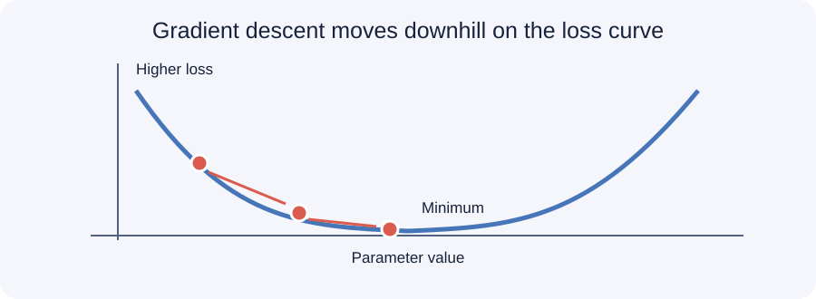

# Lesson 7: Mathematics Refresher — Calculus and Optimisation

## Learning outcomes
Explain functions, derivatives and gradients intuitively; understand loss and optimisation; perform a simple gradient-descent update; interpret learning rate and convergence; and recognise why optimisation does not guarantee generalisation.

## 1. A model is a function with adjustable parameters
A function maps inputs to outputs. A simple linear model maps x to wx + b. The values w and b are parameters. Training attempts to find parameter values that make predictions fit the training examples according to a chosen loss function.

## 2. What is a derivative?
A derivative describes how quickly a function changes when its input changes. Imagine a curve. At a point, the derivative is the slope of the tangent line. A positive derivative means the function is increasing locally; a negative derivative means it is decreasing; a zero derivative indicates a flat tangent, which may be a minimum, maximum or saddle-like point.

For f(w)=w², the derivative is 2w. At w=3, the slope is 6. Moving w slightly upward increases f; moving it downward decreases f. This tells us which direction to move if our goal is to minimise f.



## 3. From derivative to gradient
A model may have many parameters. The **gradient** is the vector of partial derivatives: one derivative for each parameter. It points in the direction of steepest local increase. To reduce the function, gradient descent moves in the opposite direction.

The basic update is:
\[
\theta_{new}=\theta_{old}-\alpha\nabla J(\theta)
\]
Here θ represents all parameters, α is the learning rate and ∇J is the gradient of the objective (loss) function.

## 4. Loss function
A loss function assigns a numerical penalty to a prediction. For a regression example, squared error is (prediction − actual)². Mean squared error averages squared errors over examples. Training aims to minimise the objective. Different losses penalise mistakes differently; choosing a loss is therefore a modelling decision, not just a technical setting.

## 5. Work through a simple derivative
Let J(w)=(w−4)². The minimum occurs at w=4. Its derivative is 2(w−4). If w=0, the derivative is −8. The gradient descent update with learning rate 0.1 is:
w_new = 0 − 0.1(−8) = 0.8.
The update moves w toward 4.

```python
w = 0.0
learning_rate = 0.1

for step in range(10):
    gradient = 2 * (w - 4)
    w = w - learning_rate * gradient
    print(step + 1, round(w, 4))
```

The values approach 4 gradually. A larger learning rate can move faster, but can also overshoot or become unstable.

## 6. Gradient descent for a tiny linear regression
```python
import numpy as np

x = np.array([1.0, 2.0, 3.0])
y = np.array([2.0, 4.0, 6.0])
w, b = 0.0, 0.0
learning_rate = 0.05

for step in range(500):
    prediction = w * x + b
    error = prediction - y
    dw = (2 / len(x)) * np.sum(error * x)
    db = (2 / len(x)) * np.sum(error)
    w -= learning_rate * dw
    b -= learning_rate * db

print("Weight:", w, "Intercept:", b)
```

For mean squared error J=(1/n)Σ(ŷ−y)², the derivative with respect to w is (2/n)Σ((ŷ−y)x), and with respect to b is (2/n)Σ(ŷ−y). The code calculates those two gradients and updates both parameters. The fitted line should approach y=2x, although exact values depend on the learning rate and number of steps.

## 7. Learning rate and convergence
- Too small: updates are tiny and training can take a long time.
- Too large: updates may jump over the minimum, oscillate or diverge.
- Suitable: the objective tends to decrease and eventually stabilise.

Feature scaling can improve optimisation because gradients may differ greatly across dimensions. More advanced optimisers adapt update sizes, but they do not remove the need to inspect training behaviour.

## 8. Local minima, convexity and stopping
A convex function has a bowl-like shape in which any local minimum is a global minimum. Non-convex objectives can have multiple local minima, flat regions and saddle points. Neural-network training is generally non-convex. Optimisation may stop after a fixed number of iterations, when improvement becomes small, or when validation performance stops improving.

## 9. Optimising training loss is not the same as generalising
A model can reduce training loss by learning noise. Validation data helps determine whether additional training or complexity improves performance on unseen examples. The optimisation algorithm solves the mathematical objective we specify; it cannot decide whether the objective, data or intended use is appropriate.

## Common mistakes
- Thinking the derivative is the loss itself.
- Moving in the direction of the gradient when minimising.
- Choosing an excessively large learning rate.
- Assuming a low training loss proves good test performance.
- Ignoring feature scales and numerical stability.

## Guided practice
For J(w)=(w−5)², calculate the derivative at w=1. Use learning rate 0.2 to perform one update by hand. Repeat using 0.01 and compare the step sizes.

## Independent practice
Implement gradient descent for a one-parameter quadratic function. Record parameter values and loss for at least 20 steps. Plot loss against step and explain what happens when the learning rate is too large.

## Knowledge check
1. What does a derivative tell us?
2. Why does gradient descent subtract the gradient?
3. What role does the learning rate play?
4. What is a loss function?
5. Why can minimising training loss still produce a poor model?

## Lesson summary
Calculus explains how model objectives change; optimisation uses that information to adjust parameters. Gradient descent is a repeated, measurable update—not a mysterious learning process.