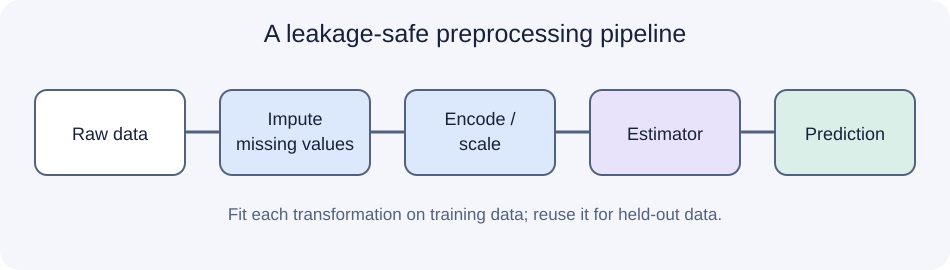

# Lesson 10: Preparing Data for Learning

## Learning outcomes
Explain why data preparation is needed; distinguish numerical and categorical preprocessing; handle missing values; encode categories; scale numerical features; use ColumnTransformer and Pipeline; and prevent preprocessing leakage.

## 1. Why data preparation matters
A dataset collected for people to read is not automatically ready for an algorithm. It may contain missing values, text categories, different measurement scales or inconsistent formats. Preparation turns raw inputs into a consistent representation suitable for a chosen model.

Preparation is not a universal cleaning recipe. The correct method depends on what a column means, why values are missing and which algorithm will use it.



## 2. Split before fitting transformations
Imagine you calculate the average income using all rows, including the future test set, then use that average to fill missing training values. Information from the test set has influenced the model preparation. This is leakage.

The safe pattern is:
1. Split rows into training and held-out data.
2. Fit imputers, encoders and scalers on training data only.
3. Apply the learned transformations to validation and test data.
4. Fit the model using the transformed training data.
5. Evaluate on transformed held-out data.

A scikit-learn Pipeline and ColumnTransformer help enforce this pattern.

## 3. Missing numerical values
An imputer replaces missing values using a defined rule. Common choices include:
- mean: useful for reasonably symmetric numeric distributions without extreme influence;
- median: more robust when values are skewed or contain outliers;
- constant: appropriate when a meaningful fixed value is justified.

Do not fill every missing value with zero automatically. Zero may be a real measurement and have a very different meaning from "not recorded".

## 4. Missing categorical values
For categories, a frequent value can be used, or missingness can be represented as an explicit category such as "Unknown". The choice depends on why the value is missing. A missing category may itself contain information, but it can also reflect a flawed data collection process.

## 5. Encode categorical variables
Many estimators require numeric input. One-hot encoding creates a binary column for each category. For example, course_level with Beginner, Intermediate and Advanced may become three indicator columns. Each row has a 1 for its category and 0 for the others.

Ordinal encoding maps ordered categories to numbers, but use it only when a genuine order exists and the numeric representation is defensible. Arbitrarily encoding nominal categories as 0, 1 and 2 can falsely imply that one category is greater or closer to another.

## 6. Scale numerical variables
Standardisation transforms a feature using its training mean and standard deviation:
\[
z = \frac{x-\mu}{\sigma}
\]
The transformed feature has mean approximately zero and standard deviation approximately one on the training data. Min-max scaling maps values to a chosen range, often 0 to 1.

Scaling is often important for distance-based algorithms, support vector machines and regularised linear models. Decision trees and random forests generally do not need standardisation to make threshold splits.

## 7. Build a ColumnTransformer pipeline
```python
import pandas as pd
from sklearn.model_selection import train_test_split
from sklearn.compose import ColumnTransformer
from sklearn.pipeline import Pipeline
from sklearn.impute import SimpleImputer
from sklearn.preprocessing import OneHotEncoder, StandardScaler
from sklearn.linear_model import LogisticRegression

df = pd.DataFrame({
    "hours": [2, 4, None, 5, 1, 7, 3, None, 6, 4],
    "attendance": [60, 80, 70, 95, 40, 98, 75, 55, 90, 85],
    "level": ["Beginner", "Intermediate", "Beginner", "Advanced",
              "Beginner", "Advanced", "Intermediate", "Beginner",
              "Advanced", "Intermediate"],
    "completed": [0, 1, 0, 1, 0, 1, 1, 0, 1, 1]
})
X = df[["hours", "attendance", "level"]]
y = df["completed"]
X_train, X_test, y_train, y_test = train_test_split(
    X, y, test_size=0.3, random_state=7, stratify=y
)

numeric_features = ["hours", "attendance"]
categorical_features = ["level"]

numeric_pipeline = Pipeline([
    ("imputer", SimpleImputer(strategy="median")),
    ("scaler", StandardScaler())
])
categorical_pipeline = Pipeline([
    ("imputer", SimpleImputer(strategy="most_frequent")),
    ("encoder", OneHotEncoder(handle_unknown="ignore"))
])
preprocessor = ColumnTransformer([
    ("numeric", numeric_pipeline, numeric_features),
    ("categorical", categorical_pipeline, categorical_features)
])
model = Pipeline([
    ("preprocess", preprocessor),
    ("classifier", LogisticRegression(max_iter=1000))
])
model.fit(X_train, y_train)
print("Test accuracy:", model.score(X_test, y_test))
```

Understand the important arguments:
- SimpleImputer(strategy="median") learns a median from training values and uses it for missing numerical values.
- StandardScaler() learns the training mean and standard deviation.
- OneHotEncoder(handle_unknown="ignore") creates category indicators and avoids crashing if a new category appears during transform; an unseen category is not represented by a learned indicator.
- ColumnTransformer applies different transformations to named column groups.
- Pipeline chains preprocessing and the estimator.
- max_iter=1000 allows logistic regression more optimisation iterations if needed.

The example is for teaching the API, not evidence that this tiny invented dataset supports a useful predictor.

## 8. Why fit and transform are different
fit learns information from data: means, medians, category levels or model parameters. transform applies the learned operation. fit_transform does both in one call. On a training set, fit_transform is common. On validation and test data, use transform through the already-fitted pipeline.

## 9. Feature engineering
Feature engineering creates useful representations from existing data. Examples include days since last purchase, average spend per order or hour of day. Every engineered feature must respect prediction time. Avoid creating a feature from future events or target-derived information.

## 10. Common mistakes
- Imputing before the split.
- Fitting a scaler on the entire dataset.
- Encoding nominal categories as arbitrary ordered numbers.
- Treating zero as equivalent to missing.
- Forgetting handle_unknown when categories may change.
- Creating features using future information.

## Guided practice
Modify the example to add a missing category and a new category in the test set. Explain how the imputer and encoder handle each case. Compare StandardScaler and MinMaxScaler on a feature with an extreme value.

## Independent practice
Choose a dataset with at least two numeric and two categorical features. Build a leakage-safe ColumnTransformer and Pipeline. Explain each transformation and justify why it is appropriate.

## Knowledge check
1. What does an imputer do?
2. Why is one-hot encoding useful?
3. Which algorithms often benefit from scaling?
4. What does fit learn compared with transform?
5. How does a pipeline reduce leakage risk?

## Lesson summary
Data preparation makes inputs consistent, but every transformation must be justified and fitted only on training data. Pipelines make this process easier to reproduce and audit.