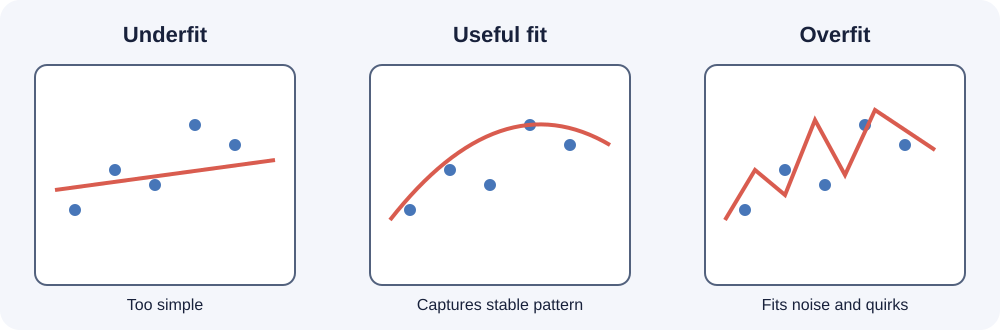

# Lesson 13: Underfitting, Overfitting and Generalisation

## Learning outcomes
Distinguish underfitting from overfitting; explain generalisation, bias and variance; compare training and validation performance; understand model complexity and regularisation; and identify practical ways to improve generalisation.

## 1. The real goal is performance on new examples
A model is trained using a sample of data. In practice, it will receive examples it has never seen. **Generalisation** describes how well it performs on data from the population and conditions where it is intended to be used.

A model that memorises training rows may achieve excellent training performance but fail on new data. A model that is too simple may fail to learn the important patterns at all. Both are problems.



## 2. Underfitting
Underfitting occurs when the model is too simple, poorly specified or insufficiently trained to capture important patterns. It usually performs poorly on both training and validation data.

Examples:
- Fitting a straight line to a strongly curved relationship.
- Using a decision tree with a depth of one when the data needs more complex splits.
- Stopping optimisation before the model has learned useful structure.

Possible responses include improving features, using a more flexible model, reducing excessive regularisation or training longer when optimisation has not converged. More complexity is not automatically better.

## 3. Overfitting
Overfitting occurs when a model learns patterns specific to the training sample, including noise and accidental details. It performs very well on training data but noticeably worse on validation or test data.

A deep decision tree can create many narrow rules that perfectly classify training examples. Some of those rules may reflect random quirks rather than stable patterns.

Possible responses:
- reduce model complexity;
- increase regularisation;
- collect more representative training examples;
- improve data quality;
- use cross-validation to select settings;
- remove leakage and unreliable features;
- stop training when validation performance no longer improves.

More data helps only when it is relevant and representative. It does not fix systematic sampling bias.

## 4. Bias and variance
Bias is error associated with assumptions that are too restrictive or systematically miss the pattern. Variance describes sensitivity to the particular training sample. High bias is often associated with underfitting; high variance is often associated with overfitting.

The bias-variance trade-off is a useful way to reason about complexity. Increasing flexibility can reduce bias but may increase variance. The aim is not to eliminate one at any cost; it is to achieve robust performance on new data.

## 5. Demonstrate model complexity with a decision tree
```python
from sklearn.datasets import make_moons
from sklearn.model_selection import train_test_split
from sklearn.tree import DecisionTreeClassifier
from sklearn.metrics import accuracy_score

X, y = make_moons(n_samples=500, noise=0.25, random_state=3)
X_train, X_valid, y_train, y_valid = train_test_split(
    X, y, test_size=0.30, random_state=3, stratify=y
)

for depth in [1, 2, 4, 10, None]:
    model = DecisionTreeClassifier(max_depth=depth, random_state=3)
    model.fit(X_train, y_train)
    train_score = accuracy_score(y_train, model.predict(X_train))
    valid_score = accuracy_score(y_valid, model.predict(X_valid))
    print(depth, "train:", round(train_score, 3),
          "validation:", round(valid_score, 3))
```

max_depth limits the maximum number of levels in the tree. A depth of 1 is very simple; None allows the tree to grow until another stopping condition applies. Compare training and validation scores. A large gap is a warning sign, not a proof on its own: data size, split variation and metric choice also matter.

## 6. Regularisation
Regularisation adds a penalty for model complexity or large parameter values. In linear models, L1 regularisation can encourage some coefficients to become exactly zero; L2 regularisation shrinks coefficients toward zero. The regularisation strength is a hyperparameter and should be selected using validation or cross-validation.

Regularisation does not simply "make the model accurate". Too much can cause underfitting; too little can permit overfitting.

## 7. Learning curves
A learning curve compares training and validation performance as the amount of training data increases. It can help diagnose whether more data might help or whether the model is too simple. If training and validation scores are both poor and close together, high bias may be present. If training is strong but validation is much worse, high variance may be present.

## 8. Training curves and early stopping
For iterative models, monitor training and validation loss across epochs or iterations. If training loss keeps falling while validation loss begins rising, the model may be overfitting. Early stopping halts training based on validation behaviour. The validation data must not be the final test set.

## 9. Common mistakes
- Choosing the model with the highest training score.
- Assuming a more complex model is always better.
- Calling every train-validation gap overfitting without checking split quality.
- Using the test set repeatedly to tune complexity.
- Believing more data automatically fixes bias or leakage.
- Applying regularisation without validation.

## Guided practice
Run the decision-tree example. Create a table of depth, training accuracy and validation accuracy. Identify a setting that underfits and one that may overfit. Explain the evidence and why the selected depth is not universally best.

## Independent practice
Train at least three models with different complexity settings on one dataset. Compare learning curves or train-validation scores. Recommend one model and state what additional evidence is needed before deployment.

## Knowledge check
1. What does generalisation mean?
2. How does underfitting differ from overfitting?
3. Explain bias and variance.
4. What does regularisation do?
5. Why should early stopping use validation rather than test data?

## Lesson summary
The goal is not to memorise training examples. It is to learn stable patterns that remain useful on new data. Complexity, regularisation and validation help manage that balance.