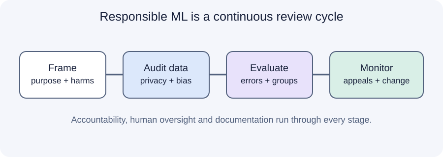

# Lesson 15: Ethics, Bias and Responsible Machine Learning

## Learning outcomes
Identify sources of bias; explain fairness and group-level performance; recognise privacy and consent concerns; understand explainability and human oversight; and design a responsible pre-deployment review.

## 1. Why responsible ML matters
Machine learning systems can influence access to education, jobs, credit, healthcare, public services and other opportunities. A model can be technically correct according to its training objective while still causing harm. Responsible ML considers people, institutions and consequences throughout the lifecycle—not only after the model is built.

## 2. Where bias can enter
Bias can arise during:
- **Problem framing:** choosing a target that represents an unfair or incomplete proxy for success.
- **Data collection:** excluding groups or regions from the sample.
- **Measurement:** recording some groups less accurately.
- **Historical decisions:** learning patterns from past discrimination or unequal access.
- **Feature selection:** including proxies for sensitive attributes.
- **Labelling:** inconsistent or subjective human labels.
- **Deployment:** using the model in a different population or context from the training data.

Removing a protected attribute does not guarantee fairness. Other variables may act as proxies. Conversely, measuring disparities may require carefully governed access to sensitive attributes. Legal and ethical review is necessary.

## 3. Fairness is not one number
Different fairness criteria answer different questions. For example:
- Do groups experience similar false-positive rates?
- Do groups experience similar false-negative rates?
- Are predicted probabilities calibrated within groups?
- Are people with similar relevant circumstances treated similarly?

These criteria can conflict, especially when underlying base rates differ. There is no universal fairness score that resolves every context. Start with the decision, affected people, harms and applicable law.



## 4. Evaluate group performance carefully
A model may have high overall accuracy but perform poorly for a smaller group. Where lawful, appropriate and supported by sufficient sample sizes, compare relevant metrics across groups. Include uncertainty and avoid drawing conclusions from tiny samples.

```python
import pandas as pd
from sklearn.metrics import confusion_matrix

results = pd.DataFrame({
    "group": ["A"] * 6 + ["B"] * 6,
    "actual":    [1, 1, 1, 0, 0, 0, 1, 1, 1, 0, 0, 0],
    "predicted": [1, 1, 0, 0, 0, 0, 1, 0, 0, 0, 1, 0]
})
for name, part in results.groupby("group"):
    tn, fp, fn, tp = confusion_matrix(
        part["actual"], part["predicted"], labels=[0, 1]
    ).ravel()
    recall = tp / (tp + fn) if tp + fn else float("nan")
    fpr = fp / (fp + tn) if fp + tn else float("nan")
    print(name, "recall:", recall, "false positive rate:", fpr)
```

This code illustrates subgroup error-rate calculations. It does not establish that a model is fair. The groups are invented, the sample is tiny and the appropriate fairness analysis depends on context.

## 5. Privacy, consent and data minimisation
Collect only information needed for a legitimate purpose. Confirm the legal basis, notice and consent requirements where applicable. Restrict access, protect data in transit and at rest, set retention limits and avoid exposing personal data in logs or notebooks.

Pseudonymised data may still be personal data if re-identification is possible. Removing names is not automatically anonymisation. Follow applicable data protection law and organisational policy.

## 6. Explainability
Explainability helps people understand why a model produced an output. A simple linear model may offer more direct coefficient interpretation than a large ensemble, but coefficients can still be misleading when features are correlated or scaled. Feature importance and SHAP-like explanations are approximations of model behaviour, not proof of causation.

The explanation should suit its audience. A data scientist may need technical diagnostics; a person affected by a decision needs a clear, meaningful explanation and a route to challenge an outcome.

## 7. Human oversight and accountability
Decide who is responsible for the system, who can override it, how people can appeal, what happens when the model is uncertain and how incidents are handled. Human review is not meaningful if reviewers are pressured to accept every model recommendation without scrutiny.

High-impact decisions may require stronger validation, independent review, audit trails, monitoring and restrictions on automated use.

## 8. Documentation and monitoring
Document intended use, excluded uses, training data, known limitations, subgroup performance, privacy controls, human oversight and monitoring plans. Monitor data drift, performance changes, unexpected outcomes and complaints. A model can become unsuitable when the population, process or environment changes.

## 9. Responsible deployment checklist
Before deployment, ask:
1. Is the target a valid and fair representation of the intended outcome?
2. Is the data representative and lawfully collected?
3. Could features act as inappropriate proxies?
4. Have errors been measured for affected groups?
5. Are privacy, security and retention controls in place?
6. Can affected people understand and challenge decisions?
7. Is a human accountable for consequential actions?
8. Is there monitoring and a plan to suspend or roll back the model?

## Common mistakes
- Assuming a high overall score means fair performance.
- Removing a sensitive feature and assuming bias disappears.
- Treating one fairness metric as universally correct.
- Using tiny subgroup samples without uncertainty.
- Calling pseudonymised data anonymous.
- Treating an explanation as causal evidence.
- Deploying without appeals, monitoring or accountability.

## Guided practice
Design a review for a model that ranks job applicants. Identify affected people, possible proxy features, false-positive and false-negative harms, group-level measures, privacy controls, human review and an appeal process.

## Independent practice
Write a responsible-ML impact assessment for a student-risk model. Describe the target, who may be affected, possible harms, group-level checks, data minimisation, human oversight and conditions under which the system must not be used.

## Knowledge check
1. Name three stages where bias can enter.
2. Why does removing a sensitive column not guarantee fairness?
3. Why can fairness metrics conflict?
4. What is the difference between pseudonymisation and anonymisation?
5. What makes human oversight meaningful?

## Lesson summary
Responsible ML is an ongoing obligation. Technical performance must be considered alongside fairness, privacy, explainability, accountability and the real consequences of model-supported decisions.